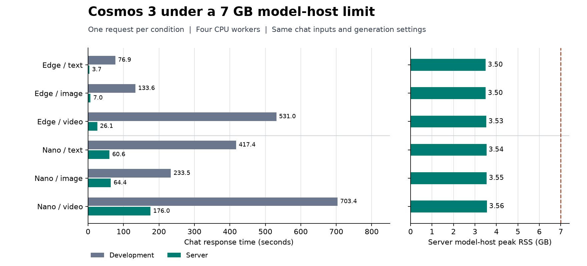

# Cosmos 3 Edge・Nano の Server 7 GB 検証

2026年11月20日。開発機で使った6件を、同じチャット中継、Monolith、システム指示、RGBフレームで再実行した。公式参照由来の回答、終了理由、生成トークンID列、入力トークン数をリクエストごとに照合した。

| モデル | 入力 | 開発機（秒） | Server（秒） | Server / 開発機 | 最大RSS（GB） | 重みの再取得を含む読込（ページ） | KV退避先からの読込（ページ） |
|---|---|---:|---:|---:|---:|---:|---:|
| Edge | 文章 | 76.9 | 3.68 | 4.8% | 3.502 | 1,665 | 0 |
| Edge | 画像 | 133.6 | 6.99 | 5.2% | 3.503 | 6,397 | 0 |
| Edge | 動画 | 531.0 | 26.12 | 4.9% | 3.531 | 12,755 | 0 |
| Nano | 文章 | 417.4 | 60.56 | 14.5% | 3.539 | 97,715 | 0 |
| Nano | 画像 | 233.5 | 64.36 | 27.6% | 3.550 | 118,366 | 0 |
| Nano | 動画 | 703.4 | 175.97 | 25.0% | 3.564 | 321,134 | 0 |

## 回答

| 条件 | Edge | Nano |
|---|---|---|
| 文章 | 4 | 4 |
| 画像 | The image is entirely red. | Red |
| 動画 | red, orange, yellow, green, blue, indigo, purple | Red, orange, green, blue. |

動画の入力は赤3枚、緑3枚、青2枚の順で、各フレームの間隔は0.5秒。両モデルとも参照と同じ未入力色を挙げており、ここでの一致は参照実装の再現性を示す。

## KVをSSDへ退避させた対照試験

重みの3 GiBキャッシュとOSの7 GB上限を固定し、先にKVだけを8 MiBに絞った。全6件で暗号化KVの再読込が発生し、参照トークン列も一致した。1回ずつ順に測っており、OSキャッシュの温まり方も影響する。

| モデル | 入力 | 8 MiB 応答（秒） | 8 MiB 最大RSS（GB） | KV再読込（回） | 8 MiB設定の書込（GB） | 標準設定の書込（KiB） |
|---|---|---:|---:|---:|---:|---:|
| Edge | 文章 | 5.25 | 3.497 | 1,792 | 0.966 | 12 |
| Edge | 画像 | 9.42 | 3.497 | 2,408 | 1.292 | 12 |
| Edge | 動画 | 35.79 | 3.500 | 15,960 | 8.586 | 12 |
| Nano | 文章 | 63.87 | 3.533 | 2,016 | 1.097 | 20 |
| Nano | 画像 | 61.86 | 3.542 | 2,448 | 1.325 | 16 |
| Nano | 動画 | 177.18 | 3.535 | 8,928 | 4.822 | 12 |

## 測定方法

- Server は AMD EPYC 9555 64-Core Processor、Linux 6.8.0-149-bet01-generic、.NET 10.0.15。開発機と同じ4ワーカー、文脈上限512、生成上限32、thinking無効、greedy。各条件1回。Edgeは先に文章でウォームアップし、Nanoは文章リクエスト中にモデルを切り替えた。モデル切り替え・重みの整合性検査は該当リクエストの時間に含む。
- 応答時間はループバックHTTPで、送信直前からチャット中継のJSONを受信するまでの経過時間。ブラウザー表示と外部回線を含まない。計測用の変更は非公開コピーだけに加え、モデルホストのキャッシュ上限を設定し、生成後にトークン列とメモリ統計を記録した。開発機は重みをメモリマップ、ServerはAIKernelの仮想メモリで管理した。
- LinuxのRLIMIT_ASを7,000,000,000バイトに固定。実メモリに加え仮想アドレス空間の予約もこの上限に含む。各リクエスト直前にモデルホストの /proc/PID/clear_refs に5を書き込み、終了時のVmHWMと0.2秒間隔の独立計測から最大値を記録した。単位GBは10億バイト。JSONに中継との合計RSSのサンプル最大も保存した。開発機の前回記録には条件別最大RSSがない。
- 不変の重みはSSD上の検証済みsafetensorsから行境界の4 MiBページで取り込み、3 GiBのRAMキャッシュを使用。変更可能なKVは標準の128 MBを上限にリクエスト専用の暗号化SSD領域へ退避する。2種類の読込回数は各生成の前後差（モデル構築時の初回読込は別）。OSページキャッシュを消去していないため、重みの論理読込回数から物理SSDの読込量は求められない。JSONのioDeltaにはLinuxが計上したストレージI/Oも収録した。
- 各shardは開発機の取り込みマニフェストとSHA-256が一致したものを使用した。参照回答の検証対象はテキスト・96×64単色画像・同サイズの8フレーム動画。公開サイトの変更を伴わない非公開検証。

検証領域のXFSはLinuxのmdデバイス上にあり、sysfsで配下の8台すべてが非回転のNVMeデバイスであることを確認した。
元データは [results.json](results.json)、照合に使った公式参照由来のトークン列は [api-generation.json](../cosmos3-20261116/api-generation.json) に収録した。
