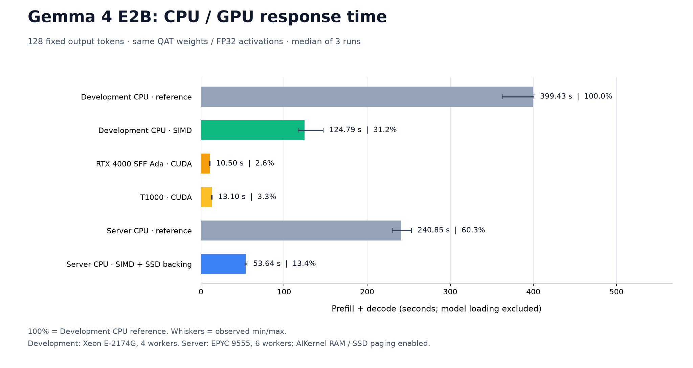

# Gemma 4 E2BのCPU／GPU最適化とServerの7GB検証

2026-11-15〜16の検証。基準は `5747fae` の参照演算です。比較用の `ReferenceCpuMatrix` とモデルの演算グラフを保ち、同じ実行器で参照／SIMD／CUDAを切り替えて測定しました。旧バイナリをそのまま計測した比較ではありません。

## 応答時間

同一QAT重み、入力23トークン、greedyで出力128トークン固定（EOSを無視、decode forwardは127回）。1 forwardのウォームアップ後に各経路を独立プロセスで3回測定し、中央値を採用しました。値はprefill＋decodeで、モデル読み込み・作業領域の確保／消去・HTTP往復は含みません。

| 経路 | 処理時間（秒） | 観測範囲（秒） | Decode（ms/token） | 開発CPU参照比 |
| --- | ---: | ---: | ---: | ---: |
| Development CPU · reference | 399.43 | 362.59–400.86 | 2755.8 | 100.0% |
| Development CPU · SIMD | 124.79 | 117.10–147.14 | 940.3 | 31.2% |
| RTX 4000 SFF Ada · CUDA | 10.50 | 10.33–10.92 | 73.5 | 2.6% |
| T1000 · CUDA | 13.10 | 12.64–13.41 | 91.4 | 3.3% |
| Server CPU · reference | 240.85 | 230.08–253.44 | 1674.2 | 60.3% |
| Server CPU · SIMD + SSD backing | 53.64 | 52.79–55.54 | 395.3 | 13.4% |

CPUの短縮率は開発機で **68.8%**、ServerのRAM予算付きSSDバックエンドで **77.7%** でした。CUDAは今回の新設経路です。GPUの改修前の実測値は存在せず、CPU参照を比較基準にしています。

開発機はXeon E-2174G、4ワーカー。開始前にCPU使用率を1秒間隔で3回確認し、すべて10%以下のときだけ開始しました。WSL停止前の初期記録は比較から除外しています。ただしWSL補助VMの再起動とバックグラウンド負荷があり、測定中の負荷を完全には隔離できていません。観測範囲を併記し、少数回の差を普遍的な性能保証とは扱いません。ServerはEPYC 9555、同じ6 CPUへのaffinityと6ワーカーを固定しました。共有ホストの他利用者の負荷は分離していません。

通常のmapped SIMD経路ではServerの中央値は42.57秒でした。RAM予算付き経路の53.64秒にはページ管理・分割実行の追加コストがあります。現在のモデルでは固定4MiBページの余白もRSSを増やします。RAMの使用量を指定できることと、速度・メモリ効率は別に評価しています。

## 7GBとSSDの扱い

7GBは十進の7,000,000,000バイトです。`Gemma4MemoryOptions` でRSS上限7GB、重みキャッシュ5GB、ランタイム等の余裕1GBを指定しました。重みの無制限mmapを解放し、AIKernelの `VirtualMemorySpace` が行境界に合わせた4MiBページをRAM／GGUF backing間で管理します。不変の重みを重複swapへ書く必要はありません。KV・活性化は文脈上限内のRAMで管理し、終了時に消去します。

| 試験 | ピークRSS（GB） | 内容 |
| --- | ---: | --- |
| paged-context-2048 | 2.531 | 入力1920＋生成128。局所KVの512境界を越えて2048枠を確認。 |
| paged-all-ple-pages | 4.409 | 入力483＋生成128。全PLEページを読むtoken ID列を使い、重みキャッシュの最大使用側を確認。 |

RSSはLinuxの子プロセス `ru_maxrss`、`/proc` の高水位、.NETのピーク値を取得し、表には大きい値を使用しました。試験ハーネスは7GB超過時に対象プロセスを停止します。エンジンはRSSと余裕を確認してキャッシュを解放し、非退避メモリだけで余裕を確保できなければ例外で停止します。OSの強制メモリ制限ではなく、OS全体の共有ファイルキャッシュもRSSには含みません。

キャッシュを32MiBへ意図的に縮める試験では、RAMは8ページ、退避済みbackingは532ページ、読み込みは16,213回になりました。Windowsではmapped SIMDとの229配列がビット一致し、Serverでも公式参照の228項目を通過しました。`SwapReads=0` は退避が無かった意味ではなく、不変GGUFを再利用するためです。再読み込みは `BackingReads` に記録します。物理SSD I/OとOSキャッシュからの読み込みの区別はこのカウンターではできません。

今回の実モデルは3,349,516,256バイトです。12GB級モデル全体の実行を証明する試験ではありません。

## 数値と回帰

公式参照は[revision固定のTransformers Gemma4TextModel](https://github.com/huggingface/transformers/blob/3a134bc37f7c22c801b618e289b0255425f22647/src/transformers/models/gemma4/modeling_gemma4.py)です。同じGoogle QAT GGUFを独立デコーダーで読み込んだFP32グラフを使い、元BF16版との量子化品質比較とは分けています。中間値・ロジットの最大絶対誤差≤1e-3、RMS≤1e-4を維持し、12ステップのtoken ID列は全経路で一致しました。

| 経路 | 比較項目 | 最大ロジット誤差 | 最大中間値誤差 |
| --- | ---: | ---: | ---: |
| cpu-numeric | 228 | 9.97e-05 | 0.000854 |
| gpu-numeric | 228 | 7.32e-05 | 0.000854 |
| t1000-numeric | 228 | 7.32e-05 | 0.000854 |
| paged-numeric | 228 | 9.97e-05 | 0.000854 |
| server-numeric | 228 | 7.77e-05 | 0.000854 |
| server-paged-numeric | 228 | 7.77e-05 | 0.000854 |

128トークン固定の今回のベンチマーク入力でも、全経路のtoken IDハッシュは一致しました: `29cc8c11ad7997fc82c61fdbd19e7846f6ace8a6f7ac71859fef754e6498637e`。

- Bonsai 1.7B／4B: CPU FP32とCUDA FP32の各910,014ロジットが基準とビット一致。CPU／CUDA Q8の10経路でも128トークンの基準ハッシュが一致。
- 単体テスト877件成功。新CUDAの独立倍精度オラクルとの比較は各GPUで30ケース成功。
- 公開Generate APIで日本語返信、キャンセル後の再生成、Dispose後の拒否を確認。GPU scratch消去失敗は呼び出し元へ報告。

## 改修内容と残る範囲

- CPU: Q4_0をレジスター内で展開し、4本のFP32アキュムレーターへ蓄積。F16／Q6_KにもSIMD内積を使用。追加の活性化量子化は行わない。
- CUDA: F16／Q4_0／Q6_Kの符号化重み1,405,796,352バイトを保持。4行／128スレッドで1行を1warpが処理し、GPU内で展開・内積・リダクションする。PLE検索表はCPU側。
- Server: 予算付き重みページングと、VirtualMemorySpaceのRAM解放APIを追加。ページ境界で借りた領域の寿命を固定し、並列計算中は退避しない。
- 新CUDAはWindowsのAda／T1000で実行。LinuxはGCC 8.5、-O3、警告をエラーとしてビルドし、新APIのexportまで確認。Linux GPU実行は今回の測定対象外。
- Attention／RoPE／GELU／KVはCPU側。GPU全forward常駐化、バッチprefill、Gemma用AVX-512／VNNIは今後の対象。Bonsaiの既存auto選択は変更していない。

Serverの12生成トークン診断では行列演算区間が参照経路の99.3%、mapped SIMDの94.4%でした。診断の計測あり／なし差はそれぞれ+1.23%／−0.85%で、各1回のため有意な差とはしません。上表の性能測定は区間計測を無効化しています。

[APIとメモリ設定](../gemma4-e2b-inference.md) · [数値・実測JSONとハッシュ](evidence/gemma4-optimization-20261115/README.md)
