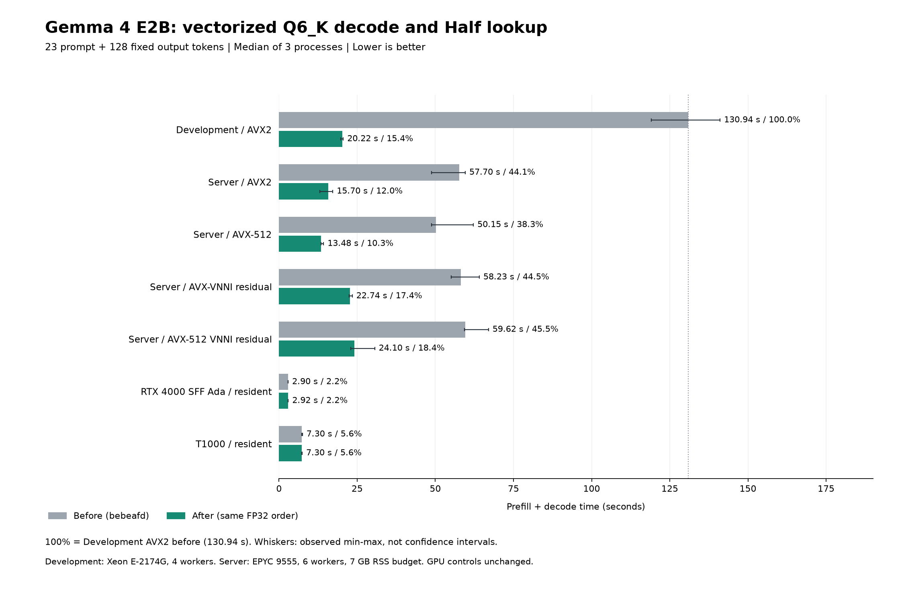

# Gemma 4 E2B: Q6_K復号とHalf変換の改善

2026-11-16。`bebeafd` を凍結した改修前バイナリーと、同じモデル・入力・実行条件で比較した。
Q6_Kの復号をAVX2／AVX-512レジスター内で行い、Half変換を表引きに変更した。
開発機の総応答時間は130.94秒から20.22秒（84.6%短縮）、Server AVX-512は50.15秒から13.48秒（73.1%短縮）となった。
測定した各経路では、改修前後の中間値・ロジットがビット単位で一致した。

## 応答時間

入力23トークン、greedy、EOSを無視して出力128トークン固定（decode forwardは127回）。
1回ウォームアップ後、独立した3プロセスで測定した中央値。計測はprefill＋decodeで、モデル読み込み、
作業領域の確保・消去、HTTPは含めない。通常「東京です。」で停止する質問なので、その後の制御トークンも含む固定回数の計算試験である。

| 経路 | 改修前（秒） | 改修後（秒） | 短縮率 | 改修後の最小–最大（秒） | Decode ms/token |
| --- | ---: | ---: | ---: | ---: | ---: |
| Development / AVX2 | 130.94 | 20.22 | 84.6% | 19.74–20.53 | 139.9 |
| Server / AVX2 | 57.70 | 15.70 | 72.8% | 13.06–17.18 | 107.2 |
| Server / AVX-512 | 50.15 | 13.48 | 73.1% | 13.42–14.23 | 90.5 |
| Server / AVX-VNNI residual | 58.23 | 22.74 | 60.9% | 22.44–23.42 | 152.9 |
| Server / AVX-512 VNNI residual | 59.62 | 24.10 | 59.6% | 23.00–30.62 | 161.4 |
| RTX 4000 SFF Ada / resident | 2.90 | 2.92 | -0.7% | 2.91–2.94 | 20.0 |
| T1000 / resident | 7.30 | 7.30 | -0.0% | 7.28–7.39 | 50.8 |

各バーの百分率は開発機AVX2の改修前130.94秒を100%とする。横線は観測した最小・最大で、信頼区間ではない。
GPU常駐経路は今回変更していない。2%未満の変化は改善と判定せず、回帰確認用の対照測定として載せた。
Serverの残差VNNIはQ4部分の近似経路であり、Q6_K出力射影の改善を受けるが、今回もFP32経路より遅い。既定経路は変更していない。

開発機はXeon E-2174G、4ワーカー、文脈1024、電源設定バランス、NVIDIAドライバー596.59。
開始前のCPU使用率を1秒間隔で3回測り、すべて10%以下となってから各測定を開始した。
ServerはEPYC 9555、6ワーカー、同じ6論理CPUへのaffinity、文脈2048。
改修前後の実行順を入れ替えて測定したが、共有ホストの他利用者負荷や開発機の測定中の背景負荷は隔離できない。
特にServerの改修前の変動が大きいため、中央値と観測範囲の両方を保存した。

## 変更と数値契約

- Q6_Kの低4ビット・高2ビットと符号付きサブスケールをレジスター内で復号する。以前の256要素作業タイルを経由しない。
- Q4_0／Q6_K／F16のHalf変換を65,536要素の共有float表に置き換える。追加容量は約256KiBで、重み全体の展開コピーは作らない。
- Q4_0が使わなかった `stackalloc float[256]` を除去し、形式ごとの分岐を行の外側へ移す。
- 復号の乗算順序、FP32のアキュムレーターと水平加算順序は従来どおり。新たなFMA、補正項のまとめ直し、活性化量子化は導入しない。

Q6_Kが大きな出力射影に使われる今回のモデルでは改善が大きかった。ただし、この実測だけからすべての形式・モデルに同じ倍率を保証しない。

## 正しさと回帰

改修前後の全42回の短時間測定は同じ128トークンのSHA-256になった。
開発機AVX2、Ada、T1000、Serverの4命令セットについて、それぞれ229個の中間配列・ロジットを改修前後で比較し、ビット単位で一致した。
独立した公式Transformersグラフとの比較は各228チェックを通過した。判定は最大絶対誤差1e-3、RMS誤差1e-4、12個の生成token ID一致である。
同じGGUFの量子化重みを独立復号したFP32参照であり、元のBF16モデルとの品質同一性を示す試験ではない。

Bonsai 1.7B／4BではCPU FP32とCUDA FP32の各910,014ロジットが既存記録と一致し、10個のQ8経路の生成ハッシュも維持した。
ローカル単体テスト889件、Server上のGemmaテスト35件がすべて成功した。
新しい行列試験は全Halfビットパターン、非整列メモリー、負・正・極端なスケール、実モデル幅を含み、旧演算順序とのビット一致を検証する。

## Serverの7GB枠とページング

CPU実行は既存のAIKernel仮想メモリーを使用する。重みキャッシュ5GB、ランタイム予約1GB、RSS予算7,000,000,000バイトで試験した。
1,920入力＋128出力の長文試験の最大RSSは2,531,364,864バイト、482入力＋128出力で広く重みを参照する試験は4,411,555,840バイトだった。
.NET、`/proc`、`ru_maxrss` の最大値を採用し、両方とも7GB以内だった。

さらにキャッシュを32MiBへ絞り、AVX-512／AVX-512 VNNIでSSD上のGGUFから16,213回読み戻す圧力試験を実施した。
通常キャッシュとの229配列のビット一致と、公式参照228チェックを維持した。
この予算はアプリケーションの制御と監視であり、OSのcgroup等による強制上限ではない。OSのファイルキャッシュはプロセスRSSと区別する。
今回扱ったGGUFは3,349,516,256バイトで、12GBモデルを7GBに収めた検証ではない。

生データ・ビルドとモデルのSHA-256・再現手順は[検証資料](evidence/gemma4-q6-20261116/README.md)に保存した。
