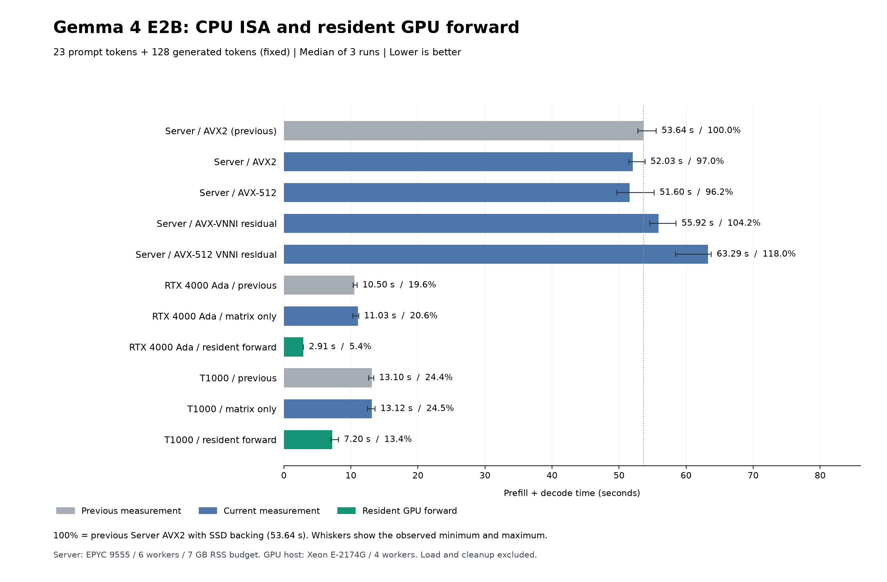

# Gemma 4 E2B: AVX-512／VNNI対応とGPU forward常駐化

2026-11-16。前回の `f04e45f` を基準に、Gemma 4 E2BのCPU命令セット指定とGPU全forwardを追加した。
GPUは総応答時間が短縮し、Serverでは7GB予算と公式参照の数値ゲートを維持した。
CPUのAVX-512は今回のAVX2との有意な差を確認できず、残差VNNIは遅くなった。結果を分けて記録する。

## 同じモデル・固定128トークンで比較

入力23トークン、greedy、出力128トークン固定、EOSを無視する。decode forwardは127回。
1 forwardのウォームアップ後、独立プロセスで各3回測定した中央値。
計測範囲はprefill＋decodeで、ロード・作業領域の確保／消去・HTTPは含めない。
通常は「東京です。」で停止する短い質問を使い、固定長試験ではその後も制御トークンを生成する。
自然な文章を128トークン回答する品質試験とは異なる。

| 経路 | 前回の記録（秒） | 今回（秒） | 今回の最小–最大（秒） | Decode ms/token |
| --- | ---: | ---: | ---: | ---: |
| Server AVX2 + SSD backing | 53.64 | 52.03 | 51.46–53.89 | 389.4 |
| Server AVX-512 + SSD backing | — | 51.60 | 49.67–55.24 | 386.4 |
| Server AVX-VNNI 残差Q8×3 | — | 55.92 | 54.60–58.51 | 413.8 |
| Server AVX-512 VNNI 残差Q8×3 | — | 63.29 | 58.40–63.75 | 467.5 |
| RTX 4000 SFF Ada・行列のみGPU | 10.50 | 11.03 | 10.27–11.15 | 77.3 |
| RTX 4000 SFF Ada・全forward常駐 | — | **2.91** | 2.89–2.93 | **19.9** |
| T1000・行列のみGPU | 13.10 | 13.12 | 12.48–13.60 | 92.4 |
| T1000・全forward常駐 | — | **7.20** | 7.05–8.15 | **50.1** |

前回の記録に対する短縮率はAdaが**72.3%**、T1000が**45.1%**。
今回測り直した行列のみGPUとの比較では、それぞれ**73.6%**、**45.1%**となった。
AVX-512と今回のAVX2の差は約0.8%で、測定範囲が重なるため速度向上とは判定しない。
VNNIは今回は高速経路として推奨せず、明示指定の実験経路として残す。

全行を同じ秒スケールで並べ、右側の百分率は前回Server AVX2の53.64秒を100%としている。
横線は3回で観測した最小・最大。タイトル、条件、環境注記は別の領域へ配置した。

開発機はXeon E-2174G、4ワーカー、文脈1024、NVIDIAドライバー596.59、バランス電源設定。
各測定前にCPU使用率が1秒間隔で3回とも10%以下であることを確認した。WSLは利用者の許可で停止した。
開始条件を満たさない間は測定せず、完了済みの記録を保持した。別の計算プロセスを一時停止する必要はなく、自然に条件を満たして完了した。
測定中の背景負荷や描画GPUの使用を完全には隔離していない。T1000の変動も観測範囲に含める。
ServerはEPYC 9555、同じ6論理CPUへのaffinity、6ワーカー、文脈2048。共有ホストの他利用者の負荷は分離していない。

## 実装した経路

### CPU

`Gemma4ExecutionOptions.InstructionSet` でAVX2／AVX-512を固定できる。
`Auto` は対応状況に応じてAVX-512 FP32、AVX2 FP32、参照経路を選ぶ。性能を学習するオートチューニングではない。
Q4_0は符号化された重みをレジスター内で展開し、AVX-512の4本のFP32アキュムレーターへ蓄積する。
F16／Q6_Kは最大256要素のタイルで処理し、重み全体の展開コピーは作らない。

VNNIは `AvxVnniResidual`／`Avx512VnniResidual` の明示指定で使用する。
32要素ごとのFP32入力を3段の残差Q8へ分け、Q4の0〜15と符号付きQ8の整数内積を計算し、
`-8 × sum(input)` を補正する。3段の復元とブロック間蓄積には倍精度を使う。
256bit版は1行、512bit版は2行の入力を共有する。F16／Q6_KはFP32経路を使う。
CPU・OS・ネイティブライブラリが未対応なら、強制指定は実行前に失敗する。

この経路は**FP32のビット完全一致を保証する整数化ではない**。追加の残差量子化を含む近似である。
今回の公式ゲートとtoken ID検証は通ったが、3段分の内積・復元処理を必要とし、総時間はAVX2より長かった。
既定のFP32から黙って切り替えず、生成メタデータの精度も `q8-residual-3` として区別する。

### GPU

`Gemma4Backend.CudaResident` を追加した。次の処理を同じCUDAストリームで接続する。

1. 符号化埋め込みの検索、PLE検索・射影。
2. RMSNorm、Q/K/V、RoPE、15所有層のKV書込みと後半20層の共有。
3. 局所／全文脈Attention、出力射影、残差、FFN、GELU、層別入力。
4. 最終正規化、ロジット、soft cap、GPU上のargmax。

位置ごとのRoPE定数を読み込み時にCPUで一度計算し、GPUへ置く。
行列カーネルは前回の4行／128スレッド、1行1warpのFP32演算を維持した。
通常のforwardでは中間値をCPUへ戻さず、最後に1回だけ同期する。
返す値はtoken IDとエラー状態の**8バイト**。公式比較時だけロジット・中間値を追加で読む。
検証用に省略したtrace領域もゼロで返し、前回の転送領域の内容が混ざらないようにした。

128トークン測定では、ウォームアップを含め151 forward／151同期／1,032バイトの読み戻しを記録した。
重みは3,332,554,752バイト、文脈1024の明示的GPU割り当ては3,363,285,056バイト、文脈2048では3,379,013,696バイト。
予算4GiBには重み・KV・作業領域・定数を含む。CUDAドライバー固有の領域と診断用転送領域は別途必要。
アップロード後はCPUの重みマップを解放し、GPU経路ではCPU側のKVコピーを確保しない。

作業領域はモデル専用として再利用し、リクエスト終了・キャンセル時にKV、活性化、ロジット、転送領域を消去する。
消去失敗は例外として報告し、実行エラー後の部分的なグラフを再利用しない。
今回まとめたのはホスト呼出し・転送・同期であり、CUDA Graph APIによるキャプチャではない。
カーネルはまだ個別に起動しており、prefillもトークンごとのforwardである。

## Serverの7GB枠とページング

7GBは7,000,000,000バイト。AIKernelのRSS監視、重みキャッシュ5GB、ランタイム余裕1GBを維持した。
テスト側も100ms間隔で子プロセスのRSSを監視する。OSによる強制cgroup上限ではなく、共有ファイルキャッシュはRSSに含めない。

| 試験 | 入力＋出力 | 最大RSS | 確認内容 |
| --- | --- | ---: | --- |
| AVX-512・長いコンテキスト | 1920＋128 | 2.531GB | 局所KVの512境界と文脈2048枠。前回CPUの生成列と一致。 |
| AVX-512・全PLEページ | 482＋128 | **4.409GB** | PLE検索表全体のページを読むID列。 |

全PLE試験のID列は今回482トークンで、前回の483トークンと異なる。この試験の所要時間を速度比較には使用しない。
最大RSSにはLinux `ru_maxrss`、`/proc` 高水位、.NETピーク値の最大を採用した。

32MiBキャッシュではRAM8ページ、backing側532ページ、`BackingReads=16,213`を記録した。
AVX-512とAVX-512 VNNIの両方で、通常キャッシュとの**229配列がビット一致**し、公式参照の228項目にも合格した。
不変のGGUFをbackingとして再利用するため `SwapReads=0` でも退避・再読込は行われる。
このカウンターは物理SSD I/OとOSキャッシュを区別しない。3.35GBの今回のモデルによる検証であり、12GBモデルの動作証明ではない。

## 数値と回帰

公式参照と前回のゲートを変更していない。同じGoogle QAT GGUFを独立したgguf-pyでデコードし、
[固定revisionのTransformers Gemma4TextModel](https://github.com/huggingface/transformers/blob/3a134bc37f7c22c801b618e289b0255425f22647/src/transformers/models/gemma4/modeling_gemma4.py)
のFP32出力と比較した。元BF16モデルとの品質・量子化誤差の比較は含まない。
最大絶対誤差≤1e-3、RMS≤1e-4、12ステップのtoken ID一致を要求する。

| 経路 | 比較項目 | 最大ロジット誤差 | 中間値を含む最大誤差 |
| --- | ---: | ---: | ---: |
| Server AVX2 | 228 | 7.77e-5 | 0.00085449 |
| Server AVX-512 | 228 | 1.03e-4 | 0.00085449 |
| Server AVX-VNNI 残差 | 228 | 8.11e-5 | 0.00085449 |
| Server AVX-512 VNNI 残差 | 228 | 9.06e-5 | 0.00085449 |
| Ada・全forward常駐 | 228 | 7.87e-5 | 0.00061035 |
| T1000・全forward常駐 | 228 | 7.87e-5 | 0.00061035 |

24回の今回の短文128トークン測定で、前回と同じハッシュ
`29cc8c11ad7997fc82c61fdbd19e7846f6ace8a6f7ac71859fef754e6498637e` を維持した。
両GPUの1920＋128試験も前回CPUの生成列と一致。これは検証した入力での確認であり、
全入力・全命令セットでのビット一致を数学的に保証するものではない。

- Bonsai 1.7B／4B: CPU FP32・CUDA FP32の各910,014ロジットが前回と全ビット一致。Q8系10経路の128トークンハッシュも一致。
- 単体テスト880件成功。ServerのAVX-512実機でもGemma関連26件を実行し成功。
- VNNIの独立倍精度オラクル8ケース成功。非整列の重み、負のscale、奇数行、1536／12288列を含む。
- GPUは日本語生成、キャンセル後の再生成、破棄後の拒否、全作業領域の消去、不正範囲・NaN・tie-breakを実機検証。
- Windows MSVCとLinux GCC 13.3でRelease相当ビルド。Linux RTX 3080 Tiでも新GPU ABIの実行・消去を確認。AVX-only検証CPUではVNNIを安全に拒否。
- ソース配布物からのWindows Releaseビルドと実GPU ABIテストも成功。

## 次の最適化候補

行ごとの積和順序を保ったMulti-Row処理、QKV／Gate+Upの一括発行、CUDA Graphを優先候補とする。
GPU上の同期を減らした現在の構成で区間計測を取り、起動・演算・帯域のどこに時間が残るか確認してから進める。
重みの連結コピーで7GB枠を圧迫しないよう、既存バッファを参照する一括発行も検討する。

整数ブロック内の並列化と、元のFP32ブロック間加算順序を保つ考え方は有効だが、
FMAの融合、スケール乗算の順序、整数の桁あふれ・飽和も同時に揃える必要がある。
GemmaのQ4×FP32とBonsaiのQ1×Q8を同一視しない。今回のBonsai回帰は誤差ゼロで、Gemmaの許容誤差とは別に確認した。
1.3〜5倍などの倍率は目標・仮説として扱い、理論帯域だけから達成を保証しない。

[APIと設定](../gemma4-e2b-inference.md) · [実測・数値比較・ビルドハッシュと再現手順](evidence/gemma4-resident-20261116/README.md)
